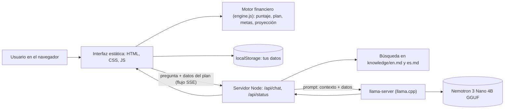

# MoneyMente

[English](README.md) | **Español**

MoneyMente es un asesor financiero personal bilingüe (español / inglés) que funciona en tu propia computadora. Escribes tus ingresos, gastos, deudas, ahorros y metas, y te muestra **dónde estás** (un puntaje de salud financiera de 0 a 100), **qué hacer después** (un plan de acción priorizado) y **cómo llegar a tus metas** (planificador de metas, proyección a varios años y proyección de retiro). Un asistente llamado **Buck** responde preguntas sobre tu plan usando **NVIDIA Nemotron en local**, **sin API key y sin servicios en la nube**.

> Herramienta educativa. No es asesoría financiera.

<!-- Agrega capturas de pantalla aquí, por ejemplo:
 -->

## Requisitos del hackathon

| Requisito | Cómo lo cumple MoneyMente |
|---|---|
| Cualquier proyecto, sobre un tema útil | Finanzas personales: presupuesto, deudas, fondo de emergencia, metas, planificación a largo plazo |
| Un bot que responda preguntas sobre el sitio, sin API key | Buck responde con los archivos de conocimiento de la app y tus números en vivo, mediante un `llama-server` local |
| Usa Nemotron | NVIDIA Nemotron 3 Nano 4B (GGUF) sobre llama.cpp |
| Repositorio público con README completo | Este repositorio, en español e inglés |

## Funciones

- **Puntaje de salud financiera**: un cuestionario de 5 preguntas (hábito de ahorro, red de seguridad, control de deudas, equilibrio de gastos, futuro e inversión) combinado con tus números reales. El puntaje aparece al completar el cuestionario.
- **Resumen**: gráfica del puntaje con sus cinco partes, tu mejor siguiente paso (con botón para escucharlo), observaciones, indicadores y un plan de acción priorizado.
- **Mis números**: selector de moneda (USD, MXN, CAD, EUR, GBP), ingresos, ahorros, inversiones, deudas y un presupuesto mensual por categoría (necesidades, gustos y categorías de ahorro como deudas, ahorros, inversiones e imprevistos) con gráficas. Si tienes deudas, aparece la comparación de pago bola de nieve vs. avalancha.
- **Metas**: todas las metas que quieras, con monto, fecha y aporte mensual. Muestra el monto necesario por mes, un estado (en camino, cerca, atrasada), una gráfica de "¿qué tan cerca estás?" y escenarios conservador / base / optimista, además de una proyección de retiro e interés compuesto.
- **Plan anual**: proyección a 1, 2, 3 o 5 años con supuestos de crecimiento de ingresos e inflación, ingresos y gastos especiales (una vez, mensual, trimestral o anual), un registro mes a mes de tus ingresos y gastos reales, una tabla resumen por año, tu mes de saldo más bajo y una sugerencia de **fondo de reserva** (cuánto apartar cada mes para gastos futuros).
- **Lista de acciones**: tareas con fecha y casillas para los hitos de tu plan.
- **Informe**: un resumen imprimible (usa **Imprimir / Guardar como PDF**) con un **resumen ejecutivo con IA** opcional escrito por Buck.
- **Buck, el asistente con IA**: una mascota moneda-robot con chat en tiempo real, un indicador de conexión y un interruptor **Deep Think** que muestra el razonamiento del modelo en un bloque desplegable. Buck puede proponer cambios a tu plan (definir ingresos, una categoría, agregar una meta, deuda o elemento especial) y nada cambia hasta que pulses **Aplicar**.
- **Guía de audio**: un tour de voz por la página y un botón "Escuchar" con las voces del navegador, con controles de voz y velocidad.
- **Temas**: claro, oscuro o del sistema.
- **Modo demo**: carga datos de ejemplo después de guardar una copia de los tuyos, con un botón **Restaurar** para recuperarlos.
- **Bilingüe**: todas las pantallas, consejos, etiquetas de gráficas, guiones de audio y respuestas del bot en español e inglés (una prueba automática verifica que ambos idiomas tengan las mismas entradas).
- **Privado por diseño**: tus datos se quedan en tu navegador (`localStorage`). Nada sale de tu computadora, salvo las solicitudes al servidor local del modelo.

## Cómo funciona



**Principio: el motor hace las cuentas, Nemotron explica.** Todos los números (puntaje, montos de metas, proyecciones, meses de pago de deudas) salen de código determinista en `public/js/engine.js`, con pruebas automáticas. El modelo nunca calcula: recibe tus números como datos y los explica en lenguaje sencillo. Así los consejos son consistentes y no se inventan cifras.

### El flujo del chat (`server.js`)

1. El navegador envía tu pregunta, el idioma, los últimos mensajes y una foto de tu plan (presupuesto, deudas, metas, proyección, plan de acción, resultados de pago de deudas). El interruptor Deep Think y el modo en tiempo real son opciones de la solicitud.
2. El servidor divide `knowledge/<idioma>.md` en secciones (`## ID | Título`) y las ordena según la pregunta con puntuación por palabras clave (raíces de 4 letras, las coincidencias en el título valen doble). La sección de tu paso actual siempre se incluye.
3. Arma un prompt de sistema: eres Buck, responde solo con el contexto y el estado del usuario, máximo 4 frases cortas, nunca inventes números, sigue el primer paso del plan de acción cuando te pregunten qué hacer después, nunca recomiendes acciones bursátiles o productos específicos.
4. Llama al `llama-server` local (API compatible con OpenAI) y devuelve la respuesta al navegador en tiempo real mediante eventos enviados por el servidor. Deep Think activa el razonamiento del modelo y permite una respuesta más larga.
5. El servidor quita el texto `<think>` de la respuesta (y lo envía aparte para el bloque desplegable), recorta finales cortados y extrae una línea opcional `ACTION_JSON` que se convierte en el botón **Aplicar**.
6. **Modo sin conexión**: si `llama-server` no está activo o falla, el chat muestra la sección de conocimiento más parecida y el indicador dice "Offline FAQ".

Otros comportamientos del servidor:

- `GET /api/status` informa si el modelo está en línea. Si no defines `LLAMA_URL`, busca `llama-server` en `127.0.0.1:8080` y luego en `127.0.0.1:9931`.
- Las solicitudes se validan: cuerpos de más de 20 KB devuelven `413`, un JSON inválido devuelve `400` y un mensaje vacío devuelve `400`.
- El puntaje de salud se oculta del bot hasta que completes el cuestionario, para que nunca explique un puntaje que aún no es real.
- Los archivos estáticos se sirven con `Cache-Control: no-store` para que siempre veas la interfaz más reciente.

### Puntaje de salud (0-100)

Cada parte combina tus números reales (60%) con tu respuesta del cuestionario (40%):

| Parte | Peso | Los números llegan a 100 cuando |
|---|---|---|
| Ahorro | 25% | ahorras el 20% o más de tus ingresos |
| Red de seguridad | 25% | tus ahorros cubren 6 meses de gastos |
| Deuda | 20% | no tienes deudas (baja conforme la deuda se acerca a un año de ingresos) |
| Equilibrio de gastos | 15% | las necesidades son como máximo 50% y los gustos 30% de tus ingresos |
| Inversión | 15% | tus inversiones equivalen a 6 meses de ingresos |

### Plan de acción

El plan se arma con tus datos y se ordena por prioridad. El primer elemento es tu "mejor siguiente paso":

1. Escribe tus ingresos y gastos
2. Corrige un déficit mensual
3. Fondo de emergencia inicial (lo menor entre 1,000 o un mes de gastos)
4. Paga tus deudas, empezando por la tasa de interés más alta
5. Fondo de emergencia completo (3 meses de gastos)
6. Pon al día las metas que van atrasadas
7. Empieza a invertir, cuando ya manejaste la deuda y el fondo de emergencia
8. Mantén tu plan

### Planificador de metas

Para cada meta con `n` meses restantes y un rendimiento anual `r`, el aporte mensual necesario es `(monto - ahorrado * (1 + i)^n) * i / ((1 + i)^n - 1)` donde `i = r / 12`. Los escenarios usan 3%, 6% y 9%. El estado usa la proyección base (6%): **en camino** con 100% del monto o más, **cerca** con 80% o más, y **atrasada** en otro caso. Si dejas vacío el aporte mensual, tu excedente se reparte en partes iguales entre las metas.

### Proyección y fondo de reserva

Cada mes: ingresos (aumentados por tu % de crecimiento) más ingresos especiales, menos gastos (tu presupuesto, ajustado por tu % de inflación) y gastos especiales, acumulado desde tus ahorros actuales. Los meses en que anotas ingresos o gastos reales en el registro usan tus valores reales. El fondo de reserva muestra el total de gastos especiales próximos y el monto mensual que conviene apartar.

## Instalación y uso

### Requisitos

- **Node.js 18 o superior**. La app no tiene dependencias de npm, así que no hay nada que `npm install`.
- **llama.cpp** (incluye `llama-server`) para el asistente con IA. Sin él la app funciona igual y el chat muestra "Offline FAQ".
- Unos **3 GB** libres de disco y memoria para el modelo de 4B. Pensado para laptops como una MacBook con chip Apple M1 y 8 GB de RAM; cierra apps pesadas mientras usas el asistente.

### macOS

```bash
brew install node llama.cpp
git clone https://github.com/beafuentes-1/moneymente.git
cd moneymente
```

Luego abre dos terminales:

```bash
# Terminal 1: Nemotron 3 Nano 4B en llama.cpp (sin API key; la primera vez descarga el modelo)
llama-server -hf nvidia/NVIDIA-Nemotron-3-Nano-4B-GGUF:Q4_K_M -c 4096 --port 8080

# Terminal 2: la app
npm start
```

Abre **http://localhost:3000**. Cuando el indicador del chat diga "Nemotron · Online", el asistente está conectado.

### Configuración

| Variable | Valor por defecto | Significado |
|---|---|---|
| `PORT` | `3000` | Puerto de la app web |
| `LLAMA_URL` | detección automática en los puertos 8080 y 9931 | URL completa del servidor del modelo, por ejemplo `http://127.0.0.1:8080/v1/chat/completions` |

### Pruebas

```bash
npm test
```

Ejecuta las pruebas del motor financiero (pago de deudas, crecimiento compuesto, metas, puntaje, presupuesto, proyección, varios años), las pruebas del servidor, la prueba de paridad de traducciones inglés/español y, si tienes Chrome instalado, una prueba de navegador de principio a fin (si no, se omite; usa `CHROME_BIN` para indicar un navegador).

## Estructura del proyecto

```
moneymente/
├── README.md / README.es.md
├── LICENSE
├── server.js                 # servidor estático, /api/chat (búsqueda + Nemotron local), /api/status
├── package.json
├── knowledge/                # base de conocimiento del asistente
│   ├── en.md
│   └── es.md
├── public/
│   ├── index.html
│   ├── css/style.css         # temas claro y oscuro
│   ├── i18n/{en,es}.json     # todos los textos en ambos idiomas
│   └── js/
│       ├── engine.js         # lógica financiera pura (sin DOM), con pruebas
│       ├── charts.js         # gráficas en canvas
│       ├── app.js            # estado, renderizado, pestañas, temas, audio, informe
│       └── chat.js           # Buck, chat en tiempo real, Deep Think, acciones del plan, selector de voz
└── tests/
    ├── engine.test.js
    ├── server.test.js
    ├── i18n.test.js
    └── browser.test.js       # opcional, requiere Chrome
```

## Personalizar

- **Enseñarle más a Buck**: agrega una sección a `knowledge/en.md` y `knowledge/es.md` con el formato `## ID | Título` seguido de un párrafo corto.
- **Agregar un idioma**: copia `public/i18n/en.json` y `knowledge/en.md`, tradúcelos, agrega el idioma al selector en `index.html` y su código al ciclo en `server.js`.
- **Cambiar supuestos**: las tasas de los escenarios y los pesos del puntaje están en `public/js/app.js` y `public/js/engine.js`.

## Limitaciones

- Son estimaciones educativas, no asesoría financiera, fiscal ni legal. Las proyecciones usan rendimientos, crecimiento e inflación fijos y supuestos.
- Un modelo de 4B aún puede equivocarse. Las respuestas se limitan a los archivos de conocimiento y a tu plan, y los números que muestra la app salen de código, no del modelo.
- Tus datos viven en el `localStorage` de un navegador: borrar los datos del sitio los elimina y no se sincronizan entre dispositivos.
- Las voces del navegador dependen de tu sistema operativo y navegador.

## Hoja de ruta

- Capturas de pantalla y un video corto de demostración
- Importar y exportar datos (CSV / JSON)
- Sincronización entre dispositivos
- Más secciones de conocimiento (impuestos, seguros, remesas)

## Licencia y créditos

MIT, ver [LICENSE](LICENSE). Hecho con [llama.cpp](https://github.com/ggml-org/llama.cpp) y NVIDIA Nemotron.
