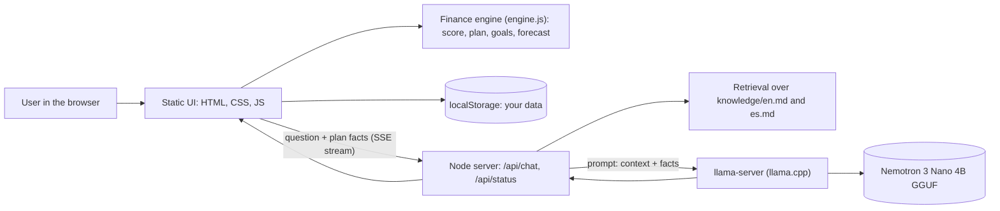

# MoneyMente

**English** | [Español](README.es.md)

MoneyMente is a bilingual (English / Spanish) personal financial advisor that runs on your own computer. You enter your income, expenses, debts, savings and goals, and it shows **where you stand** (a 0-100 financial health score), **what to do next** (a prioritized action plan) and **how to reach your goals** (goal planner, multi-year forecast, retirement projection). An assistant named **Buck** answers questions about your plan using **NVIDIA Nemotron running locally**, with **no API key and no cloud service**.

> Educational tool. It is not financial advice.

<!-- Add screenshots here, for example:
 -->

## Hackathon requirements

| Requirement | How MoneyMente meets it |
|---|---|
| Any project, on a useful topic | Personal finance: budgeting, debt, emergency funds, goals, long-term planning |
| A bot that answers questions about the site, with no API key | Buck answers from the app's knowledge files plus your live numbers, through a local `llama-server` |
| Uses Nemotron | NVIDIA Nemotron 3 Nano 4B (GGUF) on llama.cpp |
| Public repository with a full README | This repository, in English and Spanish |

## Features

- **Financial health score**: a 5-question self-assessment (saving habit, safety net, debt control, spending balance, future and investing) combined with your real numbers. The score appears once the quiz is complete.
- **Overview**: score gauge with its five parts, your next best move (with a read-aloud button), insights, KPIs and a prioritized action plan.
- **My numbers**: currency selector (USD, MXN, CAD, EUR, GBP), income, savings, investments, debts, and a monthly budget by category (needs, wants and saving categories such as debts, savings, investments and unexpected expenses) with charts. A snowball vs. avalanche debt payoff comparison appears when you have debt.
- **Goals**: any number of goals with a target, date and monthly plan. Shows the amount needed per month, a status (on track, close, behind), a "how close are you?" chart and conservative / base / optimistic scenarios, plus a retirement and compound interest projection.
- **Year plan**: a 1, 2, 3 or 5-year forecast with assumptions for income growth and inflation, special income and expenses (once, monthly, quarterly or yearly), a month-by-month ledger of your real income and expenses, a yearly summary table, your lowest-balance month and a **sinking fund** suggestion (how much to set aside each month for future expenses).
- **Action checklist**: dated tasks with checkboxes for the milestones in your plan.
- **Report**: a printable summary (use **Print / Save as PDF**) with an optional **AI executive summary** written by Buck.
- **Buck, the AI assistant**: a coin-bot mascot with a streaming chat, an online/offline status badge and a **Deep Think** switch that shows the model's reasoning in a collapsible block. Buck can propose changes to your plan (set income, a category, add a goal, debt or special item) and nothing changes until you press **Apply**.
- **Audio guide**: a voice tour of the page and a "Listen" button using your browser's built-in voices, with voice and speed controls.
- **Themes**: light, dark or system.
- **Demo mode**: loads sample data after saving a backup of yours, with a **Restore** button to bring your data back.
- **Bilingual**: all screens, tips, chart labels, audio scripts and bot answers in English and Spanish (an automated test checks that both languages have the same entries).
- **Private by design**: your data stays in your browser (`localStorage`). Nothing leaves your computer except requests to the local model server.

## How it works



**Principle: the engine does the math, Nemotron explains.** All numbers (score, goal amounts, forecasts, payoff months) come from deterministic code in `public/js/engine.js`, which is covered by tests. The model never calculates: it receives your numbers as facts and explains them in plain language. This keeps advice consistent and avoids invented figures.

### The chat pipeline (`server.js`)

1. The browser sends your question, language, recent messages and a snapshot of your plan (budget, debts, goals, forecast, action plan, debt payoff results). The Deep Think switch and streaming are options on the request.
2. The server splits `knowledge/<lang>.md` into sections (`## ID | Title`) and ranks them against the question with keyword scoring (4-letter stems, title matches count double). The section for your current step is always included.
3. It builds a system prompt: you are Buck, answer only from the context and the user state, at most 4 short sentences, never invent numbers, follow the first step of the action plan when asked what to do next, never recommend specific stocks or products.
4. It calls the local `llama-server` (OpenAI-compatible API) and streams the answer back to the browser as server-sent events. Deep Think enables the model's reasoning and allows a longer answer.
5. The server removes `<think>` text from the reply (returning it separately for the collapsible block), trims clipped endings and extracts an optional `ACTION_JSON` line that becomes the **Apply** button.
6. **Offline fallback**: if `llama-server` is not running or fails, the chat shows the best-matching knowledge section instead and the badge reads "Offline FAQ".

Other server behavior:

- `GET /api/status` reports whether the model is online. Unless `LLAMA_URL` is set, it looks for `llama-server` at `127.0.0.1:8080`, then `127.0.0.1:9931`.
- Requests are validated: bodies over 20 KB return `413`, invalid JSON returns `400`, and an empty message returns `400`.
- The health score is hidden from the bot until you complete the quiz, so it never explains a score that is not real yet.
- Static files are served with `Cache-Control: no-store` so you always see the latest UI.

### Health score (0-100)

Each part blends your real numbers (60%) with your quiz answer (40%):

| Part | Weight | The numbers reach 100 when |
|---|---|---|
| Saving | 25% | you save 20% or more of your income |
| Safety net | 25% | your savings cover 6 months of expenses |
| Debt | 20% | you have no debt (falls as debt approaches a year of income) |
| Spending balance | 15% | needs are at most 50% and wants at most 30% of income |
| Investing | 15% | your investments equal 6 months of income |

### Action plan

The plan is built from your data and ordered by priority. The first item is your "next best move":

1. Enter your income and expenses
2. Fix a monthly deficit
3. Starter emergency fund (the lower of 1,000 or one month of expenses)
4. Pay down debt, highest interest rate first
5. Full emergency fund (3 months of expenses)
6. Bring goals that are behind back on track
7. Start investing, once debt and the emergency fund are handled
8. Maintain your plan

### Goal planner

For each goal with `n` months left and a yearly return `r`, the monthly amount needed is `(target - saved * (1 + i)^n) * i / ((1 + i)^n - 1)` where `i = r / 12`. Scenarios use 3%, 6% and 9%. Status uses the base (6%) projection: **on track** at 100% of the target or more, **close** at 80% or more, otherwise **behind**. If you leave the monthly plan blank, your surplus is split equally between goals.

### Forecast and sinking fund

Each month: income (grown by your income growth %) plus special income, minus expenses (your budget, inflated by your inflation %) and special expenses, accumulated from your current savings. Months where you enter real income or expenses in the ledger use your real values. The sinking fund shows the total of upcoming special expenses and the monthly amount to set aside.

## Install and run

### Requirements

- **Node.js 18 or newer**. The app has no npm dependencies, so there is nothing to `npm install`.
- **llama.cpp** (provides `llama-server`) for the AI assistant. Without it the app still works and the chat shows "Offline FAQ".
- About **3 GB** of free disk and memory for the 4B model. Designed for laptops such as a MacBook with an Apple M1 and 8 GB of RAM; close heavy apps while using the assistant.

### macOS

```bash
brew install node llama.cpp
git clone https://github.com/beafuentes-1/moneymente.git
cd moneymente
```

Then run two terminals:

```bash
# Terminal 1: Nemotron 3 Nano 4B on llama.cpp (no API key; the first run downloads the model)
llama-server -hf nvidia/NVIDIA-Nemotron-3-Nano-4B-GGUF:Q4_K_M -c 4096 --port 8080

# Terminal 2: the app
npm start
```

Open **http://localhost:3000**. When the badge in the chat reads "Nemotron · Online", the assistant is connected.

### Configuration

| Variable | Default | Meaning |
|---|---|---|
| `PORT` | `3000` | Web app port |
| `LLAMA_URL` | auto-detect on ports 8080 and 9931 | Full URL of the model server, for example `http://127.0.0.1:8080/v1/chat/completions` |

### Tests

```bash
npm test
```

Runs the finance engine tests (payoff, compound growth, goals, score, budget, forecast, multi-year), the server tests, the English/Spanish translation parity test and, if Chrome is installed, an end-to-end browser test (otherwise it is skipped; set `CHROME_BIN` to point at a browser).

## Project structure

```
moneymente/
├── README.md / README.es.md
├── LICENSE
├── server.js                 # static server, /api/chat (retrieval + local Nemotron), /api/status
├── package.json
├── knowledge/                # the assistant's knowledge base
│   ├── en.md
│   └── es.md
├── public/
│   ├── index.html
│   ├── css/style.css         # light and dark themes
│   ├── i18n/{en,es}.json     # every text in both languages
│   └── js/
│       ├── engine.js         # pure finance logic (no DOM), unit tested
│       ├── charts.js         # canvas charts
│       ├── app.js            # state, rendering, tabs, themes, audio, report
│       └── chat.js           # Buck, streaming chat, Deep Think, plan actions, voice picker
└── tests/
    ├── engine.test.js
    ├── server.test.js
    ├── i18n.test.js
    └── browser.test.js       # optional, needs Chrome
```

## Customize

- **Teach Buck more**: add a section to `knowledge/en.md` and `knowledge/es.md` using `## ID | Title` followed by a short paragraph.
- **Add a language**: copy `public/i18n/en.json` and `knowledge/en.md`, translate them, add the language to the selector in `index.html` and its code to the loop in `server.js`.
- **Change assumptions**: scenario rates and score weights live in `public/js/app.js` and `public/js/engine.js`.

## Limitations

- Educational estimates, not financial, tax or legal advice. Projections use fixed, assumed returns, growth and inflation.
- A 4B model can still make mistakes. Answers are limited to the knowledge files and your plan, and the numbers shown in the app come from code, not from the model.
- Your data lives in one browser's `localStorage`: clearing site data deletes it, and it does not sync between devices.
- Browser voices depend on your operating system and browser.

## Roadmap

- Screenshots and a short demo video
- Import and export of data (CSV / JSON)
- Sync across devices
- More knowledge sections (taxes, insurance, remittances)

## License and credits

MIT, see [LICENSE](LICENSE). Built with [llama.cpp](https://github.com/ggml-org/llama.cpp) and NVIDIA Nemotron.
